# Zero-Copy CNI: Node Bootstrap and CNI Lifecycle

This diagram is derived from the current implementation in `daemon/`, `cmd/cni/`, `pkg/cni/`, `pkg/network/`, and `pkg/ebpf/`. It shows the order in which the node agent prepares the datapath and the CNI plugin handles pod lifecycle requests.

```mermaid
flowchart TD
    KUBELET["Kubernetes kubelet / CNI runtime"]
    DS["DaemonSet on every node\nhostNetwork + privileged"]
    ENTRY["entrypoint.sh\ninstall zero-copy-cni into /host/opt/cni/bin"]
    AGENT["daemon/main.go\nstart zero-copy-agent"]
    OBJ["/opt/zero-copy/fast-path.o"]
    LOAD["ebpf.LoadAgent()\nload xdp_pass\nreuse or pin maps and program"]
    EXIST["Attach XDP generic mode\nto existing host links named veth-*"]
    WATCH["Agent.Run()\nsubscribe to netlink link events\nand attach to newly-created veth-*"]
    MAPS["Pinned BPF state\n/sys/fs/bpf/zero-copy/\n- pod_interface_map: pod IPv4 -> host veth ifindex\n- pod_mac_map: pod IPv4 -> pod MAC\n- links/<ifindex>: pinned XDP links"]
    NODE["NODE_NAME from Downward API"]
    API["Kubernetes API\nFetchPodCIDR(node)"]
    CONFIG["SavePodCIDRToFile()\nwrite /host/etc/cni/net.d/10-zerocopy.conflist\nCNI 1.0.0 + node PodCIDR"]
    BGPQ{"ENABLE_BGP == true?"}
    BGP["InitBgp()\nGoBGP ASN 65001, port 179\nAdvertise local PodCIDR with node IP next hop\nwatch Node add/update/delete events"]
    PEERS["Node events -> AddNeighbor / RemoveNeighbor\nremote node IPv4 peers"]

    KUBELET --> DS --> ENTRY --> AGENT
    AGENT --> OBJ --> LOAD
    LOAD --> EXIST --> MAPS
    LOAD --> WATCH --> MAPS
    AGENT --> NODE --> API --> CONFIG
    CONFIG --> BGPQ
    BGPQ -- yes --> BGP --> PEERS
    BGPQ -- no --> READY["Node datapath ready"]
    PEERS --> READY
    MAPS --> READY

    READY --> CNIADD["CNI ADD invoked\nCmdArgs: ContainerID, Netns, IfName, StdinData"]
    CNIADD --> PARSE["cni.Add() -> loadConf()\nparse JSON; require cniVersion, ipam.subnet, netns"]
    PARSE --> IPAM["network.NewIPAM()\ncreate state dir; take .lock\ncreate/reuse PodCIDR prefix\nreserve first usable address as gateway\nreplay state records"]
    IPAM --> VETH["network.SetupVeth()\ncreate veth-<first 8 chars of ContainerID> + peer\nkeep host end in root namespace\nmove peer into pod netns\nrename peer to IfName and set both ends UP"]
    VETH --> ALLOC["ipam.AllocateIP()\nacquire/reuse IP from PodCIDR\natomically persist ContainerID_IfName\nassign /32 address inside pod netns"]
    ALLOC --> LINK["find host veth by name\nread pod MAC inside pod netns"]
    LINK --> ROUTE["network.AttachGwRoute()\ninside pod netns:\nadd 0.0.0.0/0 via gateway, ONLINK\nadd permanent gateway neighbor -> host veth MAC"]
    ROUTE --> IFMAP["ebpf.AddPodToFastPath()\npod IPv4 -> host veth ifindex"]
    IFMAP --> MACMAP["ebpf.AddPodMACToFastPath()\npod IPv4 -> pod interface MAC"]
    MACMAP --> RESULT["types.PrintResult()\ninterface + /32 IP + gateway + default route\nreturn CNI result to runtime"]
    RESULT --> PODREADY["Pod network configured"]

    PARSE -. error .-> FAIL["return error"]
    IPAM -. error .-> FAIL
    VETH -. error .-> FAIL
    ALLOC -. error .-> FAIL
    ROUTE -. error .-> FAIL
    IFMAP -. error .-> FAIL
    MACMAP -. error .-> ROLLBACK["defer cleanup\nremove interface map entry\nrelease IP/state record\ndelete host veth pair"]
    FAIL --> ROLLBACK

    PODREADY --> CNIDEL["CNI DEL invoked"]
    CNIDEL --> DELCONF["cni.Del()\nparse configuration without requiring live netns"]
    DELCONF --> DELIP["read persisted IP by ContainerID + IfName"]
    DELIP --> DELMAP["delete pod MAC map entry\ndelete pod interface map entry\nignore missing entries"]
    DELMAP --> DELVETH["derive host veth name\ndelete host veth\npeer in pod netns is removed with pair"]
    DELVETH --> RELEASE["release IP from allocator\nremove state record\nunlock state directory on return"]

    classDef control fill:#e9f2ff,stroke:#2563eb,color:#111827;
    classDef datapath fill:#e9f8ef,stroke:#15803d,color:#111827;
    classDef lifecycle fill:#fff4df,stroke:#c2410c,color:#111827;
    class DS,ENTRY,AGENT,OBJ,LOAD,EXIST,WATCH,NODE,API,CONFIG,BGP,PEERS control;
    class MAPS,ROUTE,IFMAP,MACMAP datapath;
    class CNIADD,PARSE,IPAM,VETH,ALLOC,LINK,RESULT,PODREADY,CNIDEL,DELCONF,DELIP,DELMAP,DELVETH,RELEASE lifecycle;
```

## Source mapping

- CNI dispatch and supported versions: [`cmd/cni/main.go`](cmd/cni/main.go)
- `ADD`, configuration validation, rollback, result: [`pkg/cni/add.go`](pkg/cni/add.go)
- `DEL` and map/veth/IPAM cleanup: [`pkg/cni/del.go`](pkg/cni/del.go)
- Veth creation and namespace movement: [`pkg/network/veth.go`](pkg/network/veth.go)
- Locking, gateway reservation, allocation, persistence, replay: [`pkg/network/ipam.go`](pkg/network/ipam.go)
- Pod default route and permanent gateway neighbor: [`pkg/network/route.go`](pkg/network/route.go)
- Pinned maps and map updates: [`pkg/ebpf/maps.go`](pkg/ebpf/maps.go)
- XDP program loading, pinning, and veth attachment: [`pkg/ebpf/loader.go`](pkg/ebpf/loader.go)
- Daemon bootstrap and optional BGP startup: [`daemon/main.go`](daemon/main.go)
- PodCIDR discovery and CNI config generation: [`daemon/k8sHandler/fetch.go`](daemon/k8sHandler/fetch.go)
- BGP node peer event handlers: [`daemon/k8sHandler/informer.go`](daemon/k8sHandler/informer.go)

## Accuracy notes

- The README mentions AF_XDP socket pairs and shared memory, but this repository contains no AF_XDP socket implementation. The implemented fast path is XDP `bpf_redirect()` in `link.XDPGenericMode`.
- The daemon starts BGP advertisement and node peer watching when `ENABLE_BGP=true`, but `BGP.Monitor()` is not started from [`daemon/main.go`](daemon/main.go); therefore the route-synchronization callback is not part of the active startup flow.
- `deploy/cni-config.yaml` is empty in the current tree. The runtime config is generated by `SavePodCIDRToFile()`.