# Zero-Copy CNI: Intra-Node Pod-to-Pod Data Path

The following figure describes the implemented same-node forwarding path. Assume pod A and pod B have already completed `CNI ADD`, their host-side veth interfaces are named `veth-a` and `veth-b` in the root namespace, and both entries exist in the pinned maps.

```mermaid
flowchart LR
    PA["Pod A network namespace\n10.244.1.2\neth0 / pod MAC A\ndefault route via 10.244.1.1"]
    VA["veth pair A\neth0 in pod A <-> veth-a in root ns"]
    XA["XDP attached to veth-a\nfast-path.c: xdp_pass"]
    FRAME["Ethernet + IPv4 frame\nsrc IP A -> dst IP B\ndst MAC initially gateway MAC"]
    PARSE["Bounds checks\nEthernet header\nIPv4 ethertype\nversion == 4\nIHL >= 5"]
    LOOKUP["pod_interface_map lookup\nkey = IPv4 destination B"]
    MISS{"Destination B\nfound?"}
    PASS["XDP_PASS\ncontinue through normal host networking"]
    MACLOOKUP["pod_mac_map lookup\nkey = IPv4 destination B"]
    REWRITE["If MAC entry exists:\nset Ethernet destination = pod MAC B"]
    REDIRECT["bpf_redirect(target ifindex, 0)\nno host route/bridge lookup needed\nfor the local fast-path decision"]
    XB["XDP attached to veth-b\nframe delivered to target host veth"]
    VB["veth pair B\nveth-b in root ns <-> eth0 in pod B"]
    PB["Pod B network namespace\n10.244.1.3\neth0 receives frame"]

    PA --> VA --> FRAME --> XA --> PARSE --> LOOKUP --> MISS
    MISS -- no --> PASS --> NORMAL["normal Linux networking path"]
    MISS -- yes --> MACLOOKUP --> REWRITE --> REDIRECT --> XB --> VB --> PB

    classDef pod fill:#fff4df,stroke:#c2410c,color:#111827;
    classDef host fill:#e9f2ff,stroke:#2563eb,color:#111827;
    classDef bpf fill:#e9f8ef,stroke:#15803d,color:#111827;
    class PA,PB pod;
    class VA,VB,FRAME host;
    class XA,PARSE,LOOKUP,MISS,MACLOOKUP,REWRITE,REDIRECT bpf;
```



## Setup state used by the data path

```mermaid
sequenceDiagram
    participant CNI as CNI ADD
    participant NS as Pod netns
    participant Host as Root namespace
    participant Maps as Pinned BPF maps
    participant XDP as xdp_pass on host veths

    CNI->>Host: SetupVeth(): create host veth + peer
    CNI->>NS: move peer; rename to eth0; set UP
    CNI->>NS: AllocateIP(): assign pod IP /32
    CNI->>NS: AttachGwRoute(): default route via gateway
    CNI->>NS: permanent neighbor gateway IP -> host veth MAC
    CNI->>Maps: pod_interface_map[pod IP] = host veth ifindex
    CNI->>Maps: pod_mac_map[pod IP] = pod eth0 MAC
    XDP-->>Host: daemon attaches xdp_pass to veth-* and watches new links
```

## Packet decision details

1. The pod sends an IPv4 packet toward the destination pod IP. The `/32` address and default route installed by `AllocateIP()` and `AttachGwRoute()` send the frame to the host-side veth through the permanent gateway neighbor.
2. `xdp_pass` validates the Ethernet and IPv4 headers. Non-IPv4, malformed, unsupported, or unknown-destination packets return `XDP_PASS`.
3. For a known local destination, `pod_interface_map` returns the destination pod's host-veth ifindex. The optional `pod_mac_map` entry supplies the destination pod MAC, which replaces the Ethernet destination MAC before redirect.
4. `bpf_redirect()` transmits the frame through the destination host veth. Its peer is in pod B's namespace, so pod B receives the frame without a Linux bridge or an IP route joining the two host veths.
5. If pod B is not in the local map, the frame follows `XDP_PASS` and normal Linux networking determines what happens next.

## Source mapping and scope

- Packet parser, map lookup, MAC rewrite, and redirect: [`ebpf/fast-path.c`](ebpf/fast-path.c)
- Destination IP to host-veth ifindex: [`pkg/ebpf/maps.go`](pkg/ebpf/maps.go)
- XDP generic-mode attachment to all `veth-*` links: [`pkg/ebpf/loader.go`](pkg/ebpf/loader.go)
- Pod IP, default route, and gateway neighbor: [`pkg/network/ipam.go`](pkg/network/ipam.go) and [`pkg/network/route.go`](pkg/network/route.go)
- End-to-end isolated redirect test: [`ebpf/test-xdp-intra-node-redirect.sh`](ebpf/test-xdp-intra-node-redirect.sh)

The cross-node path is outside this same-node fast path. The intended control-plane design is GoBGP advertisement of each node PodCIDR and remote-node peering, but the current daemon does not invoke `BGP.Monitor()` to install remote PodCIDR routes. Also, no AF_XDP rings, UMEM, or shared-memory socket pair are present in the implementation.