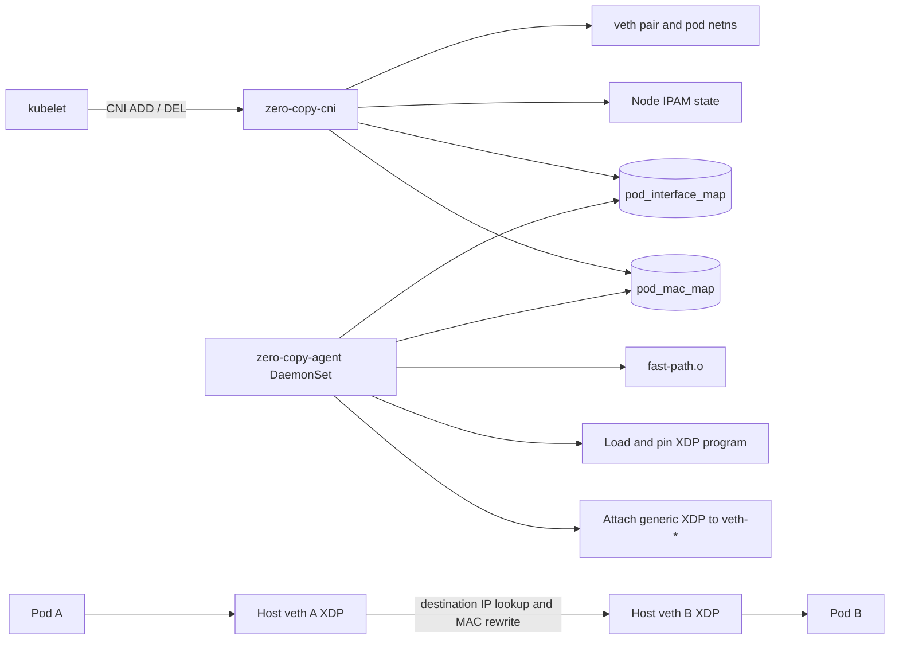

# Zero-Copy Kubernetes CNI

An experimental, high-performance Kubernetes CNI written in Go with an eBPF/XDP datapath for IPv4 pod-to-pod traffic on the same node.

The current implementation is a phase-one networking prototype. It provisions pod interfaces through the CNI lifecycle and redirects eligible intra-node packets from host-side veth interfaces with generic XDP. Inter-node routing, AF_XDP sockets, true userspace zero-copy transport, policy enforcement, and production hardening are planned but are not implemented by this release.

> **Status:** experimental. Use only on disposable clusters until the production-readiness checklist is complete.

## Contents

- [What this project does](#what-this-project-does)
- [Current scope](#current-scope)
- [Architecture](#architecture)
- [Packet path](#packet-path)
- [Repository layout](#repository-layout)
- [Requirements](#requirements)
- [Build from source](#build-from-source)
- [Build the container image](#build-the-container-image)
- [Run on Kind](#run-on-kind)
- [Run on kubeadm](#run-on-kubeadm)
- [CNI configuration](#cni-configuration)
- [Runtime state and operations](#runtime-state-and-operations)
- [Troubleshooting](#troubleshooting)
- [Validation](#validation)
- [Release artifacts](#release-artifacts)
- [Security model](#security-model)
- [Known limitations](#known-limitations)
- [Roadmap](#roadmap)
- [Production-readiness checklist](#production-readiness-checklist)
- [Contributing](#contributing)

## What this project does

The project separates node-level datapath ownership from pod lifecycle ownership:

| Component | Responsibility | Lifetime |
| --- | --- | --- |
| `zero-copy-cni` | Creates the pod veth, allocates the pod address, configures routes and neighbours, and updates BPF maps | Invoked by the kubelet for each CNI request |
| `zero-copy-agent` | Loads the eBPF object, creates or reopens pinned maps, and attaches XDP to host-side pod veths | Long-running DaemonSet, one instance per node |
| `fast-path.o` | XDP program and BPF map definitions | Loaded by the node agent |

The CNI process and the agent do not share Go memory or require an RPC protocol. They communicate through maps pinned in bpffs.

## Current scope

Implemented in phase one:

- CNI `ADD` and `DEL` handlers.
- CNI `CHECK` entrypoint accepted by the executable, without independent state validation yet.
- Deterministic host-side veth names derived from the container ID.
- Temporary peer veth naming to avoid collisions with the node's own `eth0`.
- Per-node IPv4 allocation with persisted state and a file lock.
- Pod `/32` address assignment.
- An on-link default route through a permanent gateway neighbour.
- A pinned map from destination pod IPv4 address to host veth ifindex.
- A pinned map from destination pod IPv4 address to destination pod MAC address.
- Generic XDP attachment to existing and newly-created `veth-*` interfaces.
- Ethernet destination-MAC rewrite before `bpf_redirect`.
- bpffs program, map, and link pinning.
- DaemonSet-based installation of the agent and CNI binary.
- Multi-stage image build containing the agent, CNI executable, and eBPF object.
- Local Kind validation of bidirectional same-node pod communication.

Not implemented or not production-ready:

- Inter-node pod routing.
- BGP route advertisement and reconciliation.
- AF_XDP sockets, UMEM, shared packet buffers, or userspace packet transport.
- IPv6.
- NetworkPolicy or other policy enforcement.
- CNI state migration and robust crash recovery.
- Safe replacement of arbitrary pre-existing XDP programs.
- Multi-architecture image and eBPF builds.
- Metrics, tracing, health endpoints, and structured logging.

## Architecture



### Node agent

The agent runs with host networking and elevated privileges. At startup it:

1. Loads the eBPF collection from `EBPF_OBJECT`, defaulting to `/opt/zero-copy/fast-path.o`.
2. Ensures `/sys/fs/bpf/zero-copy` exists.
3. Reuses existing pinned maps when present or pins newly-created maps.
4. Pins the XDP program at `/sys/fs/bpf/zero-copy/xdp_pass`.
5. Attaches generic XDP to existing host-side interfaces named `veth-*`.
6. Watches netlink link events and attaches to newly-created `veth-*` interfaces.

### CNI plugin

On `ADD`, the plugin:

1. Parses the CNI configuration and node subnet.
2. Acquires the node-wide IPAM lock.
3. Creates a veth pair with a temporary peer name.
4. Moves the peer into the pod network namespace and renames it to the requested interface, normally `eth0`.
5. Allocates and assigns a `/32` IPv4 address.
6. Adds an on-link default route through the node-local gateway.
7. Adds a permanent neighbour entry for the gateway.
8. Adds destination pod IP to host-veth ifindex and pod-MAC maps.
9. Prints a CNI result to stdout.

On `DEL`, the plugin removes both BPF map entries, deletes the host-side veth, and releases the persisted IP allocation. The operation is intended to tolerate a missing pod network namespace.

## Packet path

For an IPv4 packet entering a host-side pod veth:

1. The XDP program validates the Ethernet and IPv4 headers.
2. It reads `ip->daddr` as the destination pod key.
3. It looks up the destination host-veth ifindex.
4. It looks up and writes the destination pod MAC into the Ethernet header.
5. It calls `bpf_redirect` to transmit through the destination host-side veth.
6. The packet enters the destination pod namespace.

Packets that are malformed, non-IPv4, or absent from the interface map return `XDP_PASS`.

This is XDP redirect, not AF_XDP. The name `zero-copy` describes the project's performance direction; the current implementation does not yet provide a userspace zero-copy packet buffer pipeline.

## Repository layout

```text
cmd/cni/                 CNI executable entrypoint
daemon/                  Per-node agent and Kubernetes integration
daemon/bgpHandler/       Experimental BGP code, disabled by default
daemon/k8sHandler/      Node PodCIDR lookup and CNI config generation
ebpf/                    XDP C source and local test assets
pkg/cni/                 CNI ADD and DEL lifecycle
pkg/ebpf/                eBPF collection loading and pinned map access
pkg/helpers/             Deterministic interface naming
pkg/network/             veth, IPAM, route, and neighbour operations
deploy/                  DaemonSet, RBAC, and Kind configuration
Dockerfile               Multi-stage agent/CNI/eBPF image build
Makefile                 Local build targets
entrypoint.sh            Host CNI binary installation and agent startup
```

## Requirements

### Development machine

- Linux host.
- Go version compatible with `go.mod`.
- `clang` and LLVM with BPF target support.
- Linux UAPI headers, including architecture-specific headers.
- `libbpf` development headers for compilation.
- Docker for image builds.

### Kubernetes node

- Linux kernel with eBPF and generic XDP support.
- x86_64 for the current build defaults.
- A container runtime capable of running privileged pods.
- bpffs mounted at `/sys/fs/bpf` or permission to mount it.
- Host access to `/opt/cni/bin` and `/etc/cni/net.d`.
- Permission to create veth interfaces and load BPF programs.
- `hostNetwork: true` support for the node agent.

The current DaemonSet uses `privileged: true` for development and validation. A production deployment should replace this with a reviewed capability and device policy after validating the exact kernel and runtime requirements.

## Build from source

Run the unit tests and build all local artifacts:

```bash
go test ./...
make build
```

The Makefile produces:

```text
bin/zero-copy-agent
bin/zero-copy-cni
ebpf/fast-path.o
```

Build individual targets:

```bash
make build-go
make build-bpf
```

The current Makefile assumes an x86 BPF target. The Dockerfile adds the Debian x86_64 UAPI include path explicitly:

```bash
clang -O2 -g -target bpf \
  -D__TARGET_ARCH_x86 \
  -I/usr/include/x86_64-linux-gnu \
  -c ebpf/fast-path.c \
  -o ebpf/fast-path.o
```

## Build the container image

The multi-stage Dockerfile builds:

- `zero-copy-agent` from `./daemon`.
- `zero-copy-cni` from `./cmd/cni`.
- `fast-path.o` from `ebpf/fast-path.c`.

Build locally:

```bash
docker build -t zero-copy:dev .
```

Publish an image for a cluster that can pull from Docker Hub:

```bash
docker build -t <registry>/<repository>:<tag> .
docker push <registry>/<repository>:<tag>
```

For production, use an immutable version tag or image digest instead of the mutable `dev` tag.

## Run on Kind

The repository includes [deploy/kind-config.yaml](deploy/kind-config.yaml) with the default Kind CNI disabled. This is required because the test is replacing the node CNI.

Create a disposable cluster:

```bash
kind delete cluster --name zero-copy 2>/dev/null || true
kind create cluster --name zero-copy --config deploy/kind-config.yaml
kubectl config use-context kind-zero-copy
```

The published image is configured in [deploy/daemonset.yaml](deploy/daemonset.yaml). Apply it:

```bash
kubectl apply -f deploy/daemonset.yaml
kubectl -n zero-copy rollout status daemonset/zero-copy-agent --timeout=180s
```

Verify the agent, CNI binary, generated configuration, and pins:

```bash
kubectl -n zero-copy get pods -o wide

for node in $(kind get nodes --name zero-copy); do
  echo "=== $node ==="
  docker exec "$node" sh -c 'ls -l /opt/cni/bin/zero-copy-cni'
  docker exec "$node" sh -c 'cat /etc/cni/net.d/10-zerocopy.conflist'
  docker exec "$node" sh -c 'find /sys/fs/bpf/zero-copy -maxdepth 2 -type f -print'
done
```

Create two lightweight same-node pods:

```bash
TEST_NODE=zero-copy-worker2

kubectl apply -f - <<EOF
apiVersion: v1
kind: Pod
metadata:
  name: zero-copy-a
spec:
  nodeName: ${TEST_NODE}
  containers:
  - name: test
    image: busybox:1.36
    command: ["sh", "-c", "sleep 3600"]
---
apiVersion: v1
kind: Pod
metadata:
  name: zero-copy-b
spec:
  nodeName: ${TEST_NODE}
  containers:
  - name: test
    image: busybox:1.36
    command: ["sh", "-c", "sleep 3600"]
EOF

kubectl wait --for=condition=Ready pod/zero-copy-a --timeout=180s
kubectl wait --for=condition=Ready pod/zero-copy-b --timeout=180s
kubectl get pods -o wide
```

Test both directions:

```bash
POD_A_IP=$(kubectl get pod zero-copy-a -o jsonpath='{.status.podIP}')
POD_B_IP=$(kubectl get pod zero-copy-b -o jsonpath='{.status.podIP}')

kubectl exec zero-copy-a -- ping -c 5 -W 2 "$POD_B_IP"
kubectl exec zero-copy-b -- ping -c 5 -W 2 "$POD_A_IP"
```

The expected phase-one result is successful bidirectional ping with no packet loss. Inspect the pod route and neighbour state:

```bash
kubectl exec zero-copy-a -- ip -4 addr show dev eth0
kubectl exec zero-copy-a -- ip route
kubectl exec zero-copy-a -- ip neigh
```

Expected shape:

```text
10.244.x.y/32
default via 10.244.x.1 dev eth0 onlink
10.244.x.1 ... PERMANENT
```

Clean up the disposable cluster:

```bash
kubectl delete pod zero-copy-a zero-copy-b --ignore-not-found
kind delete cluster --name zero-copy
```

## Run on kubeadm

Use a disposable kubeadm cluster. Replacing a running production CNI can disconnect every pod on the node.

Before installation:

```bash
kubectl get nodes -o wide
kubectl get pods -A
sudo ls -la /etc/cni/net.d
sudo ls -la /opt/cni/bin
mountpoint /sys/fs/bpf || true
```

Back up the existing CNI configuration:

```bash
sudo mkdir -p /root/cni-backup
sudo cp -a /etc/cni/net.d/. /root/cni-backup/ 2>/dev/null || true
```

Build and publish the image, update the image in `deploy/daemonset.yaml`, and apply it:

```bash
kubectl apply -f deploy/daemonset.yaml
kubectl -n zero-copy rollout status daemonset/zero-copy-agent --timeout=180s
```

The agent writes one configuration file per node:

```text
/etc/cni/net.d/10-zerocopy.conflist
```

The generated configuration contains the node's Kubernetes `PodCIDR` and selects `zero-copy-cni` as the plugin executable. Do not remove the old CNI configuration until the agent has installed the new binary and configuration on every node. After validation, delete the test pods before restoring the original CNI.

## CNI configuration

The daemon generates a configuration equivalent to:

```json
{
  "cniVersion": "1.0.0",
  "name": "zero-copy-ebpf-cni",
  "plugins": [
    {
      "type": "zero-copy-cni",
      "ipam": {
        "type": "host-local",
        "subnet": "10.244.1.0/24"
      }
    }
  ]
}
```

The plugin consumes `ipam.subnet` and maintains its own persisted allocator state. The `type` field is retained as configuration metadata; the plugin does not invoke the external `host-local` binary.

Optional state directory configuration is supported by the Go configuration type:

```json
{
  "ipam": {
    "subnet": "10.244.1.0/24",
    "stateDir": "/var/lib/cni/zero-copy"
  }
}
```

## Runtime state and operations

### Host paths

| Path | Purpose |
| --- | --- |
| `/opt/cni/bin/zero-copy-cni` | CNI executable invoked by the runtime |
| `/etc/cni/net.d/10-zerocopy.conflist` | Generated CNI configuration |
| `/var/lib/cni/zero-copy` | IPAM records and lock file |
| `/sys/fs/bpf/zero-copy/xdp_pass` | Pinned XDP program |
| `/sys/fs/bpf/zero-copy/pod_interface_map` | Pod IPv4 to host-veth ifindex |
| `/sys/fs/bpf/zero-copy/pod_mac_map` | Pod IPv4 to destination MAC |
| `/sys/fs/bpf/zero-copy/links/` | Pinned XDP links by interface index |

### Environment variables

| Variable | Default | Description |
| --- | --- | --- |
| `NODE_NAME` | none | Kubernetes node name injected into the agent DaemonSet |
| `EBPF_OBJECT` | `/opt/zero-copy/fast-path.o` | Path to the compiled eBPF object |
| `ENABLE_BGP` | unset | Experimental BGP path; leave unset for phase-one testing |

### Inspecting state

```bash
kubectl -n zero-copy logs -l app=zero-copy-agent -c go-app --prefix=true

find /sys/fs/bpf/zero-copy -maxdepth 2 -type f -print
ip -br link
```

If `bpftool` is installed on the node:

```bash
bpftool link show
bpftool prog show pinned /sys/fs/bpf/zero-copy/xdp_pass
bpftool map show pinned /sys/fs/bpf/zero-copy/pod_interface_map
bpftool map show pinned /sys/fs/bpf/zero-copy/pod_mac_map
```

## Troubleshooting

### Agent exits with `no such file or directory` under `/sys/fs/bpf`

Confirm the filesystem type, not just that the path exists:

```bash
grep ' /sys/fs/bpf ' /proc/self/mountinfo
```

The entry should identify `bpf`. The DaemonSet init container mounts bpffs when necessary.

### Agent exits with `device or resource busy`

This usually means an earlier agent instance left generic XDP attached to a veth while its pinned link was lost. On a disposable Kind cluster, delete the test pods first, remove orphaned `veth-*` links only after confirming they belong to the test pods, and restart the agent.

```bash
kubectl delete pod zero-copy-a zero-copy-b --ignore-not-found
kubectl -n zero-copy rollout restart daemonset/zero-copy-agent
```

For production, stale-link replacement and ownership-aware cleanup must be implemented before relying on automatic recovery.

### Pods remain in `ContainerCreating`

```bash
kubectl describe pod <pod>
kubectl -n zero-copy get pods -o wide
kubectl -n zero-copy logs <agent-pod> -c go-app
```

Common causes include a missing CNI binary, stale CNI configuration, a missing PodCIDR, insufficient privileges, or an interface-name collision.

### Ping fails and the pod shows a `/24` address

The current datapath requires `/32` pod addresses and an on-link default route through the permanent gateway neighbour. Rebuild and republish the image, restart the agent, delete the old pods, and recreate them.

### Image changes are not visible

The development manifest uses `imagePullPolicy: Always`, but a running DaemonSet does not automatically restart just because a mutable tag changed:

```bash
kubectl -n zero-copy rollout restart daemonset/zero-copy-agent
kubectl -n zero-copy rollout status daemonset/zero-copy-agent --timeout=180s
```

Use immutable version tags or digests outside development.

## Validation

Run Go tests and build checks:

```bash
go test ./...
go build ./daemon ./cmd/cni
make build
```

Build the image:

```bash
docker build -t zero-copy:dev .
```

The primary functional test is bidirectional ping between two pods pinned to the same node. This validates CNI provisioning, `/32` route setup, gateway neighbour configuration, XDP attachment, BPF map population, destination-MAC rewrite, and veth redirect.

The current local Kind validation demonstrated bidirectional same-node ping with 0% packet loss and approximately 0.12 ms average round-trip latency. These values are environment-specific and are not performance guarantees.

## Release artifacts

For an x86_64 Linux release, publish:

```text
zero-copy-agent-linux-amd64
zero-copy-cni-linux-amd64
fast-path-linux-amd64.o
zero-copy-<version>-linux-amd64.tar.gz
SHA256SUMS
```

The CNI executable is installed as:

```text
/opt/cni/bin/zero-copy-cni
```

The agent and object are deployed by the DaemonSet image. Release images should use immutable tags, signed provenance, and a digest-pinned deployment manifest.

## Security model

The current DaemonSet requires:

- `hostNetwork: true`.
- Privileged execution.
- Access to `/sys/fs/bpf`.
- Write access to host CNI directories.
- Permission to create and delete host-network veth interfaces.
- Permission to load and attach eBPF programs.
- Kubernetes access to read node `PodCIDR` values.

The Kubernetes service account is currently granted `get`, `list`, and `watch` on `nodes`. The agent does not require write access to Kubernetes resources for the phase-one path.

Before production use, reduce privileges to the minimum supported capability set and add admission, image-signing, seccomp, AppArmor, and node-isolation controls appropriate to the target environment.

## Known limitations

1. The datapath is IPv4-only.
2. The XDP program uses generic/SKB mode for veth compatibility; it is not native driver-mode XDP.
3. The implementation uses XDP redirect and does not implement AF_XDP or userspace shared-memory transport.
4. Only same-node pod forwarding is validated.
5. Inter-node routing is not implemented.
6. BGP support is experimental and disabled by default.
7. The agent currently treats XDP attachment conflicts as fatal rather than safely replacing only program instances owned by this agent.
8. `CHECK` is accepted but does not yet perform full state validation.
9. The mutable `dev` image tag is suitable for testing only.
10. Metrics, health probes, structured logs, upgrade coordination, and stale-state reconciliation are incomplete.
11. The current build targets x86_64 and does not publish multi-architecture images.

## Roadmap

### Phase two: inter-node networking

- Define node-to-node routing and next-hop ownership.
- Advertise and reconcile pod CIDRs safely.
- Implement BGP or an alternative node routing control plane.
- Add cross-node integration tests.
- Add failure detection and route withdrawal.

### Phase three: operational maturity

- Add Prometheus metrics and health/readiness endpoints.
- Add structured logs and event correlation.
- Implement `CHECK` validation and idempotent recovery.
- Add safe XDP link ownership and replacement.
- Add startup reconciliation for stale veths, maps, and IPAM records.
- Add upgrade, rollback, and node-drain procedures.
- Publish signed, digest-pinned images and multi-architecture artifacts.

### Phase four: zero-copy transport research

- Evaluate AF_XDP sockets and UMEM.
- Define queue, CPU-affinity, and NUMA behavior.
- Benchmark latency, throughput, packet rate, and CPU utilization.
- Compare against established CNIs and kernel routing paths.

## Production-readiness checklist

This project should not be described as production-ready until the following are complete:

- [ ] Inter-node networking and route reconciliation.
- [ ] Safe replacement and ownership of XDP links.
- [ ] Crash-safe map, veth, and IPAM reconciliation.
- [ ] Full CNI `CHECK` support.
- [ ] Multi-node and upgrade/rollback integration tests.
- [ ] Metrics, health checks, alerts, and structured logs.
- [ ] Least-privilege security profile.
- [ ] Signed images and immutable deployment references.
- [ ] Multi-architecture build and compatibility matrix.
- [ ] Performance and regression benchmarks.
- [ ] Documented support policy and incident recovery process.

## Contributing

Before opening a change:

```bash
gofmt -w .
go test ./...
make build
git diff --check
```

Changes that modify packet behavior should include a reproducible test plan covering pod creation, same-node traffic, pod deletion, agent restart, and stale-state recovery. Changes to the eBPF object should be tested against the kernel versions and architectures supported by the release.
